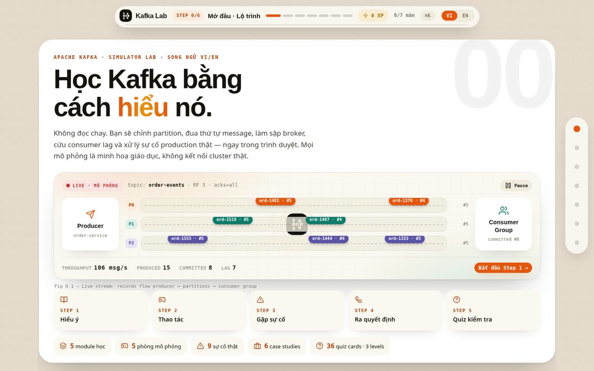
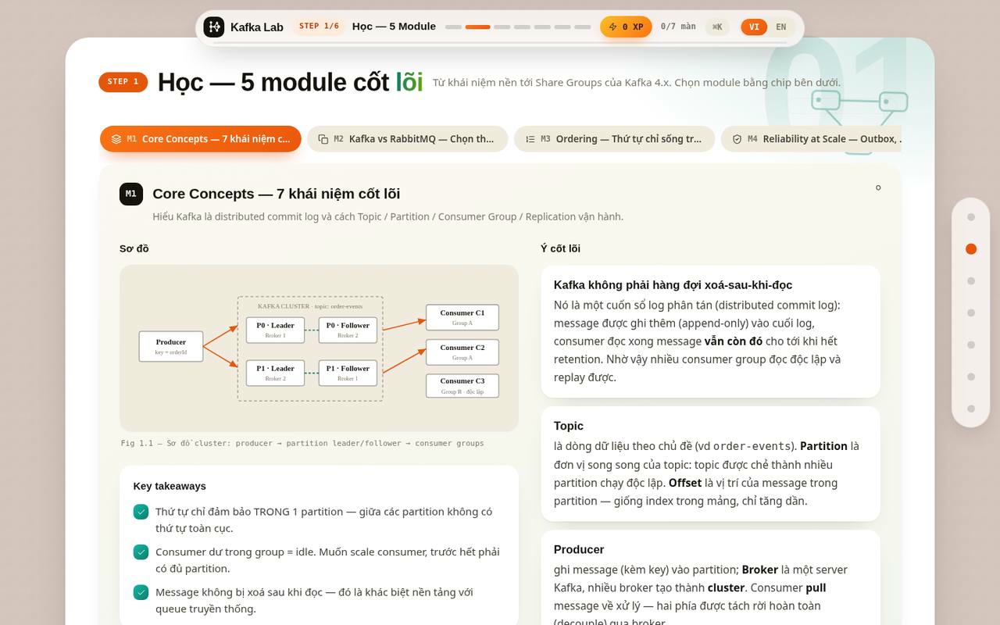
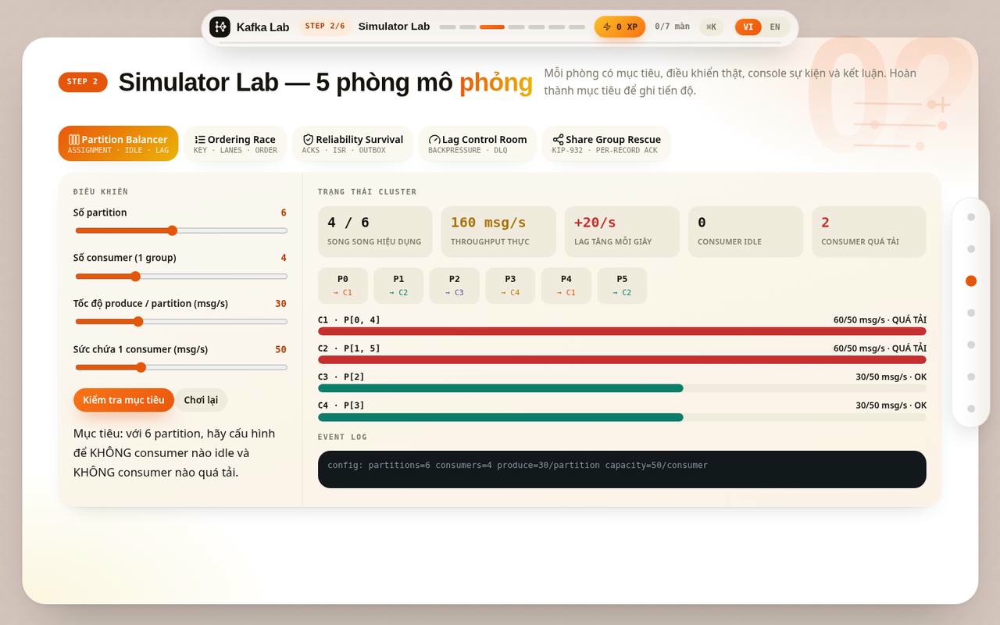
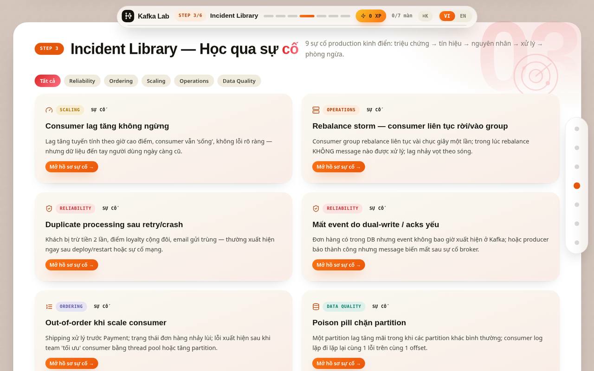
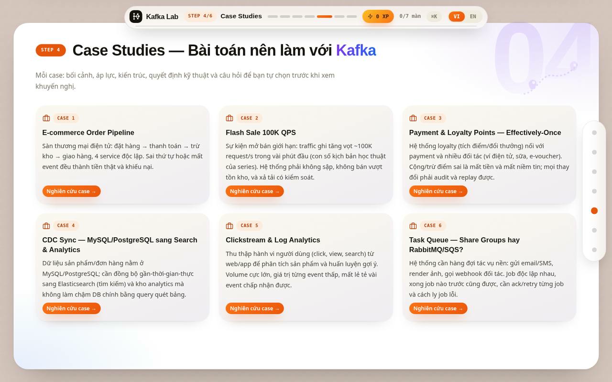
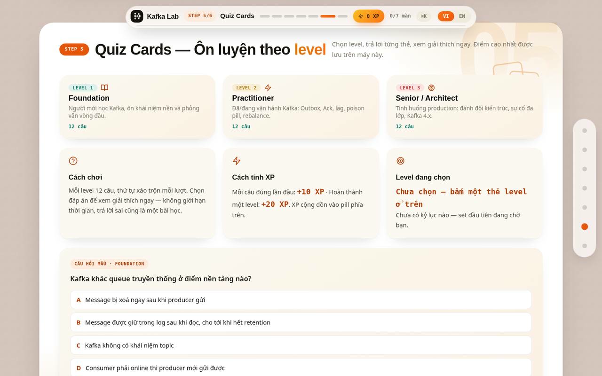
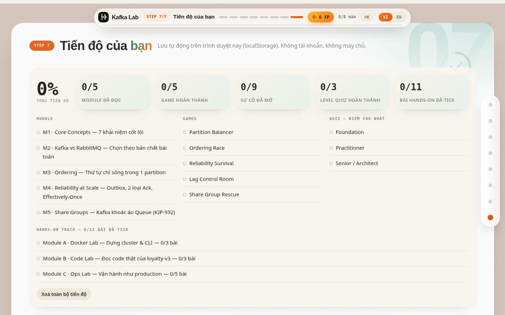
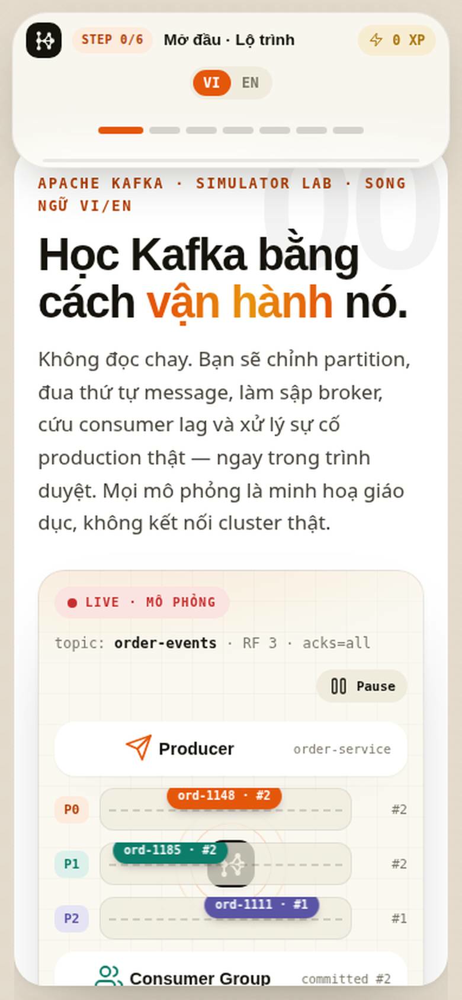

<div align="center">

# 🧪 Kafka Lab — Learn by Operating

**Học Apache Kafka bằng cách vận hành nó — không đọc chay.**
*Learn Apache Kafka by operating it — not by reading about it.*

[](https://kafka-learning-platform.vercel.app)
[](#)
[](#run-it)
[](#progress--xp)



<sub>Step 0 — the live stream stage: records with keys & offsets flow Producer → Partitions → Consumer Group, with real throughput / produced / committed counters.</sub>

</div>

---

## ✨ Why Kafka Lab?

Most Kafka tutorials stop at definitions. Kafka Lab turns every concept into something you
**touch, break, and fix**:

- 🎛️ **Operate, don't memorize** — drag sliders to rebalance partitions, race message
  ordering strategies, crash brokers, and rescue a drowning consumer group.
- 🧭 **One-page Step Journey** — the whole course lives on a single page as 7 full-screen
  steps. A floating glass pill always tells you where you are (`STEP n/6`), and the bullet
  rail / `⌘K` jumper teleports you anywhere.
- ⚡ **Micro-wins** — finishing a module, beating a simulator goal, opening an incident
  dossier or acing a quiz card earns XP that flies up to the header pill. Progress is saved
  locally — no account, no backend.
- 🌏 **Fully bilingual** — every lesson, game, incident, case study and quiz card exists in
  Vietnamese and English; switch instantly from the pill.

## 🗺️ The journey — 7 steps

| Step | Block | What happens there |
|-----:|-------|--------------------|
| 0 | **Intro · Roadmap** | Live stream stage, course map, your stats |
| 1 | **Learn** | 5 deep-dive modules with diagrams, takeaways & common mistakes |
| 2 | **Simulator Lab** | 5 hands-on games with goals, live metrics & event logs |
| 3 | **Incident Library** | 9 production incidents as full diagnostic dossiers |
| 4 | **Case Studies** | 6 architecture cases — you decide first, then compare |
| 5 | **Quiz Cards** | 36 questions across Foundation / Practitioner / Senior |
| 6 | **Progress** | XP, completion dashboard & per-level learning paths |

## 📸 Screenshots

| Learn — 5 modules | Simulator Lab — Partition Balancer |
|---|---|
|  |  |

| Incident Library | Case Studies |
|---|---|
|  |  |

| Quiz Cards | Progress dashboard |
|---|---|
|  |  |

<div align="center">

<br><sub>Responsive down to small phones — the step pill and bullet menu stay fully tappable (44px targets).</sub>
</div>

## 🎮 Simulator Lab — the 5 games

| Game | Concept you master | Win condition |
|------|--------------------|---------------|
| **Partition Balancer** | Partitions × consumers, parallelism ceiling | No idle consumer, no overloaded consumer |
| **Ordering Race** | Per-key ordering, 4 processing strategies | Zero ordering violations, best time |
| **Reliability Survival** | `acks`, ISR, Outbox pattern, idempotency | Survive 3 crash points with zero data loss |
| **Lag & Backpressure Control Room** | Consumer lag, poison pills, DLQ | Drain the lag before the SLA burns |
| **Share Group Rescue** | KIP-932 Share Groups, per-record ack | Clear the queue with ACCEPT / RELEASE / REJECT |

## 📚 Content inventory

- **5 modules** — Core Concepts · Kafka vs RabbitMQ · Message Ordering ·
  Reliability at Scale (Outbox / CDC / Saga, the two ack types, `acks=all` & ISR) ·
  Share Groups (KIP-932)
- **9 incident dossiers** — symptoms, the metrics that matter, root cause, step-by-step
  diagnosis, the fix, and how to prevent a repeat
- **6 case studies** — e-commerce event pipeline, 100K QPS flash sale, payments & loyalty,
  CDC database sync, clickstream analytics, queue-technology selection
- **36 quiz cards** — 12 per level, instant feedback with explanations, wrong-answer review

## 🏃 Run it

It's a **single static `index.html`** — no build step, no dependencies, works offline.

```bash
# Option 1: just open it
open index.html

# Option 2: serve it
npx serve .
```

Deploy anywhere static files live — this repo is wired to Vercel, so every push to `main`
ships a new production build automatically.

## 🧱 Project structure

```text
.
├── index.html                  # the entire app (content, games, styles, i18n)
├── README.md
└── docs/
    └── screenshots/            # README screenshots (self-contained SVG captures)
```

## 💾 Progress & XP

Progress lives in your browser's `localStorage`: modules read, game goals beaten,
incidents/cases opened, best quiz scores per level, and total XP. Clearing site data
resets it. Nothing is sent to a server — the simulations are educational models and
never connect to a real Kafka cluster.

## 🙏 Credits & trademark

Content synthesized from the Kafka video series by
[Anonystick / Tips Javascript](https://www.youtube.com/@anonystick) and fact-checked
against the Apache Kafka documentation, KIP-932, microservices.io and Debezium docs.

> Apache Kafka® is a registered trademark of the Apache Software Foundation.
> This is an independent learning project — not affiliated with, sponsored, or endorsed
> by the Apache Software Foundation.
